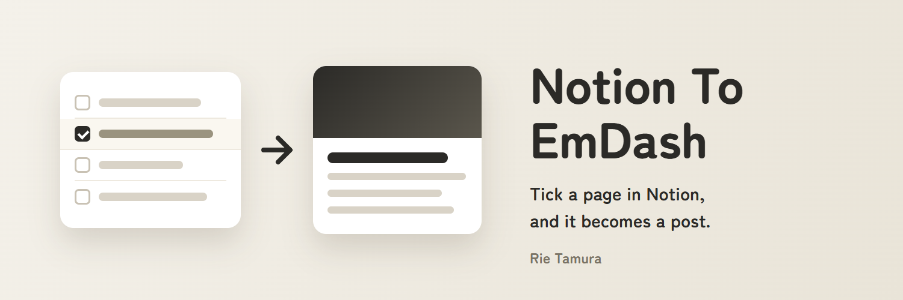

# Notion To EmDash



Posts pages from a Notion database to an [EmDash](https://emdashcms.com) site as posts (`posts`). Tick a page's "公開" (publish) box in Notion, and it appears on the site.

This repository holds two tools that share the Notion reading and conversion code:

- **The EmDash plugin**: runs inside your site, checks Notion every few minutes and sends the pages. You set it up in the admin. It cannot draw thumbnails.
- **The GitHub Actions tool**: runs on GitHub on a schedule. It can do the whole job by itself, including thumbnails, or only draw thumbnails for the posts the plugin sends.

[日本語](README_JA.md)

## Which to use

| | Plugin | Plugin + Actions thumbnails | Actions tool only |
| --- | --- | --- | --- |
| Set up in | The EmDash admin | The admin and GitHub | GitHub |
| Runs | In your site, every 5 minutes (you can change it) | Plugin as on the left; thumbnails every 30 minutes | Every 30 minutes |
| Posts with no image | No featured image | Get an automatic thumbnail | Get an automatic thumbnail |
| URL (slug) from the Notion "スラッグ" property | No: made from the title | No: made from the title | Yes |

Automatic thumbnails use the design from the [Auto Thumbnail Design](https://github.com/RieTamura/Auto-Thumbnail) plugin, so that plugin must be on the site too. Drawing one takes 30–150 ms of CPU, more than a plugin run has, which is why the plugin does not draw them.

## What it does

- Sends the Notion pages whose "公開" box is ticked, oldest edit first.
- When you edit a page in Notion after it was sent, it updates the same post.
- Copies the images stored in Notion into the EmDash media library (Notion's image links stop working after about an hour).
- Picks the featured image in this order: the Notion "アイキャッチ" (featured image) file, then the first body image. The Actions tool then draws a thumbnail if there is still none. A featured image chosen in the admin is never replaced.
- Writes the post URL and the time back to the Notion page, so one page never makes two posts.

Deleting a page in Notion, or unticking it, leaves the post on the site. Delete posts in the EmDash admin.

## Set up Notion (both tools)

### 1. The database

Add these properties. The Actions tool can use other names (the `PROP_*` [settings](#actions-settings)); the plugin uses these names.

| Property | Type | | Use |
| --- | --- | --- | --- |
| (title) | Title | required | The post title. Any name works |
| 公開 | Checkbox | required | Only ticked pages are sent |
| EmDash URL | URL | required | Written by the tool. Empty means "not sent yet" |
| 送信日時 | Date | required | Written by the tool |
| スラッグ | Text | | Actions tool only: part of the post URL. When empty, it is made from the title |
| 抜粋 | Text | | The post excerpt, used in search results and share cards |
| カテゴリ | Select | | Must match a category on the site; a page with an unknown category is not sent |
| タグ | Multi-select | | Tags missing on the site are created |
| アイキャッチ | Files | | The first image becomes the featured image |

Do not edit "EmDash URL" or "送信日時" by hand. To send a page again as a new post (for example, one sent to another site), empty both.

### 2. The integration

1. In [Notion integrations](https://www.notion.so/profile/integrations), make a new internal integration.
2. Give it "Read content" and "Update content" (it writes back what it sent).
3. Copy its secret (`ntn_…`). You can show it again later on the same page.
4. Open the database page, then "…" → "Connections", and add the integration.

Use one integration for both tools. Each tool tells its own edits from a person's by the integration's user, so a second integration would make every sent page look edited and send it again.

## The EmDash plugin

### Install

| From | Runs | Cloudflare plan | Install and update |
| --- | --- | --- | --- |
| The EmDash plugin registry | In the plugin sandbox | **Workers Paid** (the sandbox needs it) | From the admin |
| GitHub | In-process, with your site | **Workers Free is fine** | `npm install`, then **deploy** |

**From the registry**: in the admin, open **Registry**, search for **Notion To EmDash** and install it.

**From GitHub**: install it and add it to `astro.config.mjs`. npm builds it on install; the drawing library of the Actions tool is not installed on your site.

```sh
npm install github:RieTamura/Notion-To-EmDash
```

```js
import notionToEmdash from "notion-to-emdash";

emdash({
	// ...
	plugins: [notionToEmdash],
});
```

Then deploy. To update it later, run the same `npm install` again and deploy.

### The site needs an encryption key

The plugin stores the Notion secret encrypted, so the site needs `EMDASH_ENCRYPTION_KEY`. Without it the settings page cannot save the secret and says so.

```sh
npx emdash secrets generate --write .env.encryption-key
# Cloudflare: put the value in the Worker's secrets
npx wrangler secret put EMDASH_ENCRYPTION_KEY
# Local development: put the same line in .dev.vars
```

Keep a copy of the key somewhere safe. Without it, saved secrets cannot be read; you would have to enter them again.

### Set it up

1. In the admin, open **Notion To EmDash**.
2. Enter the integration secret and the database (its link or ID), choose **Published posts** or **Drafts**, and press **Save**.
3. Press **Check the connection**. It reads the database and says how many pages it would send, without sending anything. A wrong secret, a database the integration cannot see, or missing properties are explained here.
4. Press **Send now** to send right away, or wait for the next scheduled run.

The page also shows the last run, the page being sent, and pages that could not be sent with the reason. A page that could not be sent (for example, its category is not on the site) is skipped until you edit it in Notion.

### How it runs

- Every 5 minutes by default. Change **How often to check** (a cron expression) to change it. The site's own Cron Trigger is the shortest possible interval.
- One page at a time, in small steps (read the page, upload one image, save, mark Notion). A page with many blocks or images takes a few runs. In the sandbox each run stays within its call limit.
- **The slug cannot be set.** EmDash plugins cannot choose a post's slug, so it is made from the title; a Japanese title gives a Japanese URL. Change the slug in the admin, or use the Actions tool, if you need a set URL.
- Images stored in Notion are uploaded. Images linked from other sites stay as links. An image larger than 8 MiB is left out.
- The URL written back to Notion uses the site's address (`siteUrl` / `EMDASH_SITE_URL`), even on a development server. Do not point a development server at the database your live site uses: it would send the pages to itself first and mark them as sent.

### Capabilities

| Capability | Why |
| --- | --- |
| `network:request` (`api.notion.com`, `prod-files-secure.s3.us-west-2.amazonaws.com`) | Read the database and the images stored in Notion |
| `schema:read` | Check that the site has a `posts` collection |
| `content:write`, `content:publish` | Make, update and publish posts |
| `taxonomies:write` | Find categories, create missing tags, attach them |
| `media:write` | Upload the images |

### Routes

All are admin-only.

| Route | Does |
| --- | --- |
| `POST /_emdash/api/plugins/notion-to-emdash/sync` | One run now |
| `POST /_emdash/api/plugins/notion-to-emdash/check` | Check the connection and count the pages to send |
| `admin` | The settings page |

## The GitHub Actions tool

### 1. Make an EmDash API token

In the admin, go to Users → API tokens and make a token with `content:read`, `content:write` and `media:write`. The token (`ec_pat_…`) is shown only once, so copy it right away.

### 2. Put this repository on your GitHub

Fork this repository. GitHub Actions is off in a fork, so open the fork's "Actions" tab and turn it on.

### 3. Add the secrets

In the fork, open Settings → Secrets and variables → Actions → Secrets, and add:

| Name | Value |
| --- | --- |
| `NOTION_TOKEN` | The integration secret (not needed for thumbnails only) |
| `NOTION_DATABASE_ID` | The database link or its ID (not needed for thumbnails only) |
| `EMDASH_URL` | The site address, e.g. `https://example.com` |
| `EMDASH_TOKEN` | The token from step 1 |

With the [GitHub CLI](https://cli.github.com/), `gh secret set NOTION_TOKEN -R <you>/Notion-To-EmDash` asks for the value without showing it. Until they are set, scheduled runs end without doing anything.

### 4. Choose what the scheduled runs do

Set the variable `MODE` (Settings → Secrets and variables → Actions → Variables):

- `publish` (default): send and publish the ticked pages, with thumbnails.
- `thumbnails`: only draw thumbnails for posts with no featured image. **Use this with the plugin**, so the two never send the same pages.

### 5. Try it

In the "Actions" tab, choose "Notion To EmDash", then "Run workflow":

- `dry-run` lists what it would send and sends nothing. Missing database properties are reported here.
- `draft` sends the ticked pages as drafts.
- `thumbnails` draws the missing thumbnails now.

### Actions settings

Variables, all optional.

| Name | Default | Meaning |
| --- | --- | --- |
| `MODE` | `publish` | What scheduled runs do: `publish`, `draft` or `thumbnails` |
| `MAX_POSTS` | `5` | Most pages sent, or thumbnails drawn, in one run. The rest go in later runs |
| `AUTO_THUMBNAIL` | `true` | `false` turns off automatic thumbnails when sending |
| `THUMBNAIL_SKIP` | (none) | Slug beginnings, comma separated, of posts that never get a thumbnail, e.g. `weekly-,about` |
| `TZ` | `Asia/Tokyo` | Time zone of the date drawn on the thumbnail |
| `PROP_PUBLISH` … `PROP_SENT_AT` | the names above | Property names: `PROP_PUBLISH`, `PROP_SLUG`, `PROP_EXCERPT`, `PROP_CATEGORY`, `PROP_TAGS`, `PROP_FEATURED_IMAGE`, `PROP_EMDASH_URL`, `PROP_SENT_AT` |

To change how often it runs, edit the `cron` line in `.github/workflows/notion-to-emdash.yml`. The default is every 30 minutes.

When drawing thumbnails only, a thumbnail is written as the post's featured image alone, nothing else changes. A published post is published again so the image shows. A published post with unpublished changes is left alone, because publishing it would put those changes live.

### Things to know

- **Runs are not on time.** GitHub may start a scheduled run several minutes late when it is busy.
- **Schedules stop after 60 days.** In a public repository with no commits for 60 days, GitHub turns off scheduled runs. Turn them back on in the "Actions" tab.
- **Free minutes:** free for public repositories. Private repositories get 2,000 minutes a month; every 30 minutes fits, every 15 minutes does not.
- **Posts in the trash** keep their slugs, so a new post cannot use the same slug. Empty the trash or change the slug.
- **Tokens** belong in secrets only, never in files or logs. If one leaks, make a new one in Notion or EmDash and replace it.

## How the body is converted

| Notion | Site |
| --- | --- |
| Heading 1–4 | Heading 2–5 (the post title is the heading 1) |
| Paragraph, bulleted and numbered lists, quote, code, divider, table | As is |
| Bold, italic, strikethrough, underline, inline code, links | As is |
| To-do | Bulleted list starting with ☐ or ☑ |
| Callout | Quote (an emoji icon goes in front) |
| Toggle, columns | Their content, laid out in order |
| Equation | LaTeX code |
| Image stored in Notion | Uploaded to the media library |
| Image linked from another site | Uploaded by the Actions tool; kept as a link by the plugin |
| Bookmark, embed, video or file at an outside URL | A link |
| Sub-page, database, file stored in Notion | Not sent |
| Link to another Notion page | Its text only |

## Development

Needs Node.js 24 or later.

```bash
npm install
npm test                  # type check, manifest check, all tests
npm run build             # build the plugin into dist/
```

The Actions tool runs on your computer too. Copy `.env.example` to `.env` and fill it in.

```bash
npm start                         # list only, send nothing
npm start -- --send               # send as drafts
npm start -- --publish            # publish
npm start -- --dump               # save the converted body to out/
npm start -- --thumbnails         # list posts without a featured image
npm start -- --thumbnails --send  # draw their thumbnails
```

The code is in `src/shared/` (Notion reading and conversion, used by both), `src/plugin.ts` and `src/plugin/` (the plugin), and `src/action/` (the Actions tool). Plugin tests run in EmDash's workerd-based test host (`tests/plugin/`); the tool's tests run in Node (`tests/action/`).

## Reporting a problem

Open an issue at [github.com/RieTamura/Notion-To-EmDash/issues](https://github.com/RieTamura/Notion-To-EmDash/issues). Do not paste tokens or secrets.

## License

MIT
