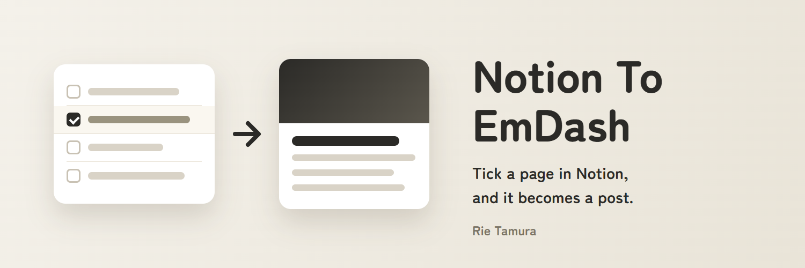

# Notion To EmDash



Notion のデータベースに書いたページを、[EmDash](https://emdashcms.com) のサイトに記事（`posts`）として送ります。Notion でページの「公開」に印を付けると、サイトに出ます。

このリポジトリには、Notion を読む部分と本文を変換する部分を共有する、2 つの道具が入っています。

- **EmDash のプラグイン**：サイトの中で動き、数分ごとに Notion を見て、ページを送ります。設定は管理画面でします。サムネイルは描けません。
- **GitHub Actions のツール**：GitHub の上で決まった間隔で動きます。サムネイルまで含めて 1 つですべてを行うことも、プラグインが送った記事のサムネイルだけを描くこともできます。

[English](README.md)

## どれを使うか

| | プラグイン | プラグイン ＋ Actions のサムネイル | Actions のツールだけ |
| --- | --- | --- | --- |
| 設定する場所 | EmDash の管理画面 | 管理画面と GitHub | GitHub |
| 動き方 | サイトの中で 5 分ごと（変えられます） | プラグインは左と同じ。サムネイルは 30 分ごと | 30 分ごと |
| 画像のない記事 | アイキャッチなし | 自動サムネイルが付く | 自動サムネイルが付く |
| Notion の「スラッグ」で URL を決める | できない（タイトルから作られる） | できない（タイトルから作られる） | できる |

自動サムネイルは [Auto Thumbnail Design](https://github.com/RieTamura/Auto-Thumbnail) プラグインのデザインで描くので、サイトにそのプラグインも必要です。**そのプラグインは GitHub から入れてください。** レジストリから入れると、自動で作った ID で動くため、デザインが見つからず、サムネイルが描かれません（[emdash-cms/emdash#4335](https://github.com/emdash-cms/emdash/issues/4335)）。1 枚描くのに CPU を 30〜150 ミリ秒使い、プラグインの 1 回の実行で使える量を超えるため、プラグインでは描きません。

## できること

- Notion で「公開」に印を付けたページを、編集が古い順に送ります。
- 送ったあとに Notion でページを直すと、同じ記事を更新します。
- Notion に置いた画像は、EmDash のメディアにアップロードします（Notion の画像の URL は約 1 時間で使えなくなるため）。
- アイキャッチは次の順で決めます：Notion の「アイキャッチ」、なければ本文の最初の画像。それでもなければ、Actions のツールが自動サムネイルを描きます。管理画面で選んだアイキャッチは上書きしません。
- 記事の URL と送った日時を Notion に書き戻します。同じページから記事が 2 つできることはありません。

Notion でページを消したり、「公開」の印を外したりしても、サイトの記事はそのまま残ります。消すときは EmDash の管理画面で消してください。

## Notion の準備（どちらでも同じ）

### 1. データベース

次の列を作ります。Actions のツールは列の名前を変えられます（[設定](#actions-の設定)の `PROP_*`）。プラグインはこの名前を使います。

| 列の名前 | 種類 | | 使い方 |
| --- | --- | --- | --- |
| （タイトル） | タイトル | 必須 | 記事のタイトル。列の名前は何でも構いません |
| 公開 | チェックボックス | 必須 | 印があるページだけを送ります |
| EmDash URL | URL | 必須 | 道具が書き込みます。空なら「まだ送っていない」 |
| 送信日時 | 日付 | 必須 | 道具が書き込みます |
| スラッグ | テキスト | | Actions のツールだけ：記事の URL の一部。空ならタイトルから作ります |
| 抜粋 | テキスト | | 記事の抜粋。検索結果やシェアの説明文に使われます |
| カテゴリ | セレクト | | サイトにあるカテゴリと同じ名前にします。サイトにないカテゴリだと送りません |
| タグ | マルチセレクト | | サイトにないタグは作ります |
| アイキャッチ | ファイル | | 最初の画像をアイキャッチにします |

「EmDash URL」と「送信日時」は手で書き換えないでください。別のサイトに送ったページなど、新しい記事として送り直したいときは、両方を空にします。

### 2. インテグレーション

1. [Notion のインテグレーション](https://www.notion.so/profile/integrations)で、新しい内部インテグレーションを作ります。
2. 機能は「コンテンツを読み取る」と「コンテンツを更新」にします（送った印を書き戻すため）。
3. シークレット（`ntn_…`）をコピーします。あとから同じ画面で表示し直せます。
4. データベースのページを開き、右上の「…」→「接続」から、作ったインテグレーションを追加します。

プラグインと Actions のツールでは、同じインテグレーションを使ってください。どちらも「最後に直したのがインテグレーションか、人か」で送り直すかを決めます。インテグレーションを分けると、送ったページがすべて「人が直した」ように見えて、送り直しになります。

## EmDash のプラグイン

### 入れ方

| 入れ方 | 動く場所 | Cloudflare のプラン | 入れ方と更新 |
| --- | --- | --- | --- |
| EmDash のプラグインレジストリ | プラグインのサンドボックス | **Workers Paid**（サンドボックスに必要） | 管理画面から |
| GitHub | サイトと同じプロセス | **Workers Free で大丈夫** | `npm install` のあと**デプロイ** |

**レジストリから**：管理画面の「Registry」で **Notion To EmDash** を探して入れます。

**GitHub から**：入れて、`astro.config.mjs` に足します。入れるときに npm がビルドします。Actions のツールが使う描画の部品は、サイトには入りません。

```sh
npm install github:RieTamura/Notion-To-EmDash
```

```js
import notionToEmdash from "notion-to-emdash";

emdash({
	// ...
	plugins: [notionToEmdash],
});
```

そのあとデプロイします。更新するときも、同じ `npm install` をしてからデプロイします。

### サイトに暗号化のキーが要る

プラグインは Notion のシークレットを暗号化して保存するので、サイトに `EMDASH_ENCRYPTION_KEY` が要ります。ないと設定画面でシークレットを保存できず、そう知らせます。

```sh
npx emdash secrets generate --write .env.encryption-key
# Cloudflare：値を Worker の secret に入れる
npx wrangler secret put EMDASH_ENCRYPTION_KEY
# 手元の開発：同じ行を .dev.vars に入れる
```

キーの控えを安全な場所に取っておいてください。なくすと、保存したシークレットが読めなくなり、入れ直すことになります。

### 設定

1. 管理画面で **Notion To EmDash** を開きます。
2. インテグレーションのシークレットとデータベース（リンクか ID）を入れ、「公開する」か「下書きにする」を選んで **保存** します。
3. **接続を確かめる** を押します。データベースを読み、次に送るページの数を出します。何も送りません。シークレットが違う、インテグレーションからデータベースが見えない、列が足りない、といったときは、ここで理由が出ます。
4. すぐに送るなら **今すぐ送る** を押します。押さなくても、次の定期実行で送ります。

この画面には、最後の実行、送っている途中のページ、送れなかったページとその理由も出ます。送れなかったページ（たとえば、カテゴリがサイトにない）は、Notion で直すまで飛ばします。

### 動き方

- 初期値は 5 分ごとです。**見に行く間隔**（cron の書き方）で変えられます。サイトの Cron Trigger より短くはできません。
- 1 回に 1 ページを、小さな段（本文を読む、画像を 1 枚上げる、保存する、Notion に印を付ける）に分けて進めます。ブロックや画像の多いページは、数回に分けて送ります。サンドボックスでも、1 回の呼び出しの上限に収まります。
- **スラッグは指定できません。** EmDash のプラグインからは記事のスラッグを決められないため、タイトルから作られます。日本語のタイトルは、日本語の URL になります。URL を決めたいときは、管理画面で直すか、Actions のツールを使ってください。
- Notion に置いた画像はアップロードします。ほかのサイトの画像はリンクのまま残します。8 MiB より大きい画像は外します。
- Notion に書き戻す URL は、開発サーバーでもサイトのアドレス（`siteUrl` / `EMDASH_SITE_URL`）を使います。本番と同じデータベースを開発サーバーにつながないでください。開発サーバーが先に送って、送った印を付けてしまいます。

### 権限

| 権限 | 使い道 |
| --- | --- |
| `network:request`（`api.notion.com`、`prod-files-secure.s3.us-west-2.amazonaws.com`） | データベースと、Notion に置いた画像を読む |
| `schema:read` | サイトに `posts` コレクションがあるかを確かめる |
| `content:write`、`content:publish` | 記事を作る、直す、公開する |
| `taxonomies:write` | カテゴリを探し、ないタグを作り、記事に付ける |
| `media:write` | 画像をアップロードする |

### ルート

どれも管理者だけが使えます。URL は GitHub から入れた場合のものです。レジストリから入れた場合は、`notion-to-emdash` の代わりに自動で作った ID（`r_…`）になります。ID は、管理画面のプラグインのページの URL に出ます（[emdash-cms/emdash#4335](https://github.com/emdash-cms/emdash/issues/4335)）。

| ルート | すること |
| --- | --- |
| `POST /_emdash/api/plugins/notion-to-emdash/sync` | 今すぐ 1 回動かす |
| `POST /_emdash/api/plugins/notion-to-emdash/check` | 接続を確かめ、送るページの数を数える |
| `admin` | 設定画面 |

## GitHub Actions のツール

### 1. EmDash の API トークンを作る

管理画面の「ユーザー」→「API トークン」で作ります。権限は `content:read`、`content:write`、`media:write` の 3 つです。トークン（`ec_pat_…`）は作ったときに 1 回だけ表示されるので、すぐにコピーします。

### 2. このリポジトリを自分の GitHub に置く

このリポジトリをフォークします。フォークでは GitHub Actions が止まっているので、フォークの「Actions」タブを開いて有効にします。

### 3. Secrets を入れる

フォークの Settings → Secrets and variables → Actions → Secrets に入れます。

| 名前 | 値 |
| --- | --- |
| `NOTION_TOKEN` | インテグレーションのシークレット（サムネイルだけなら不要） |
| `NOTION_DATABASE_ID` | データベースのリンクか ID（サムネイルだけなら不要） |
| `EMDASH_URL` | サイトのアドレス。例：`https://example.com` |
| `EMDASH_TOKEN` | 手順 1 のトークン |

[GitHub CLI](https://cli.github.com/) なら、`gh secret set NOTION_TOKEN -R <自分>/Notion-To-EmDash` で、値を画面に出さずに入れられます。入れるまでは、定期実行は何もせずに終わります。

### 4. 定期実行ですることを選ぶ

変数 `MODE` を入れます（Settings → Secrets and variables → Actions → Variables）。

- `publish`（初期値）：印の付いたページを送って公開します。サムネイルも描きます。
- `thumbnails`：アイキャッチのない記事に、サムネイルだけを描きます。**プラグインと一緒に使うときはこれにします。** 2 つが同じページを送らないようにするためです。

### 5. 試す

「Actions」タブで「Notion To EmDash」を選び、「Run workflow」で動かします。

- `dry-run`：送るものを一覧にするだけで、何も送りません。データベースの列が足りないときは、ここで分かります。
- `draft`：印の付いたページを下書きで送ります。
- `thumbnails`：足りないサムネイルを今すぐ描きます。

### Actions の設定

Variables に入れます。どれも省略できます。

| 名前 | 初期値 | 意味 |
| --- | --- | --- |
| `MODE` | `publish` | 定期実行ですること：`publish`、`draft`、`thumbnails` |
| `MAX_POSTS` | `5` | 1 回に送るページ、または描くサムネイルの上限。残りは次の回に回します |
| `AUTO_THUMBNAIL` | `true` | `false` にすると、送るときに自動サムネイルを描きません |
| `THUMBNAIL_SKIP` | （なし） | サムネイルを描かない記事のスラッグの頭。カンマで区切ります。例：`weekly-,about` |
| `TZ` | `Asia/Tokyo` | サムネイルに描く日付の時間帯 |
| `PROP_PUBLISH` … `PROP_SENT_AT` | 上の列の名前 | 列の名前：`PROP_PUBLISH`、`PROP_SLUG`、`PROP_EXCERPT`、`PROP_CATEGORY`、`PROP_TAGS`、`PROP_FEATURED_IMAGE`、`PROP_EMDASH_URL`、`PROP_SENT_AT` |

動く間隔を変えるときは、`.github/workflows/notion-to-emdash.yml` の `cron` の行を書き換えます。初期値は 30 分ごとです。

サムネイルだけを描くときは、記事のアイキャッチだけを書き換え、ほかは変えません。公開済みの記事は、画像が出るように公開し直します。ただし、公開済みで、まだ公開していない変更がある記事には触りません。公開し直すと、その変更まで出てしまうためです。

### 気をつけること

- **定期実行は時間どおりとは限りません。** GitHub が混んでいると、数分遅れることがあります。
- **60 日で定期実行が止まります。** 公開リポジトリで 60 日間コミットがないと、GitHub が定期実行を止めます。「Actions」タブで有効に戻してください。
- **無料で使える時間：** 公開リポジトリなら無料です。非公開リポジトリは月 2,000 分までで、30 分ごとなら収まりますが、15 分ごとだと超えます。
- **ゴミ箱の記事**もスラッグを持ったままなので、同じスラッグで新しい記事は作れません。ゴミ箱を空にするか、スラッグを変えてください。
- **トークン**は Secrets にだけ入れ、ファイルやログには書かないでください。漏れたときは、Notion か EmDash で作り直して入れ替えます。

## 本文の変換

| Notion | サイト |
| --- | --- |
| 見出し 1〜4 | 見出し 2〜5（見出し 1 は記事のタイトル） |
| 段落、箇条書き、番号付きリスト、引用、コード、区切り線、表 | そのまま |
| 太字、斜体、取り消し線、下線、インラインコード、リンク | そのまま |
| ToDo | ☐ か ☑ で始まる箇条書き |
| コールアウト | 引用（絵文字のアイコンを先頭に付けます） |
| トグル、段組み | 中身を順に並べます |
| 数式 | LaTeX のコード |
| Notion に置いた画像 | メディアにアップロード |
| ほかのサイトの画像 | Actions のツールはアップロード、プラグインはリンクのまま |
| 外の URL のブックマーク、埋め込み、動画、ファイル | リンク |
| サブページ、データベース、Notion に置いたファイル | 送りません |
| ほかの Notion ページへのリンク | 文字だけ残します |

## 開発

Node.js 24 以上が要ります。

```bash
npm install
npm test                  # 型チェック、manifest の確認、すべてのテスト
npm run build             # プラグインを dist/ にビルド
```

Actions のツールは手元でも動きます。`.env.example` を `.env` に写して書き込みます。

```bash
npm start                         # 一覧だけ。何も送らない
npm start -- --send               # 下書きで送る
npm start -- --publish            # 公開する
npm start -- --dump               # 変換した本文を out/ に保存する
npm start -- --thumbnails         # アイキャッチのない記事を一覧にする
npm start -- --thumbnails --send  # そのサムネイルを描く
```

コードは `src/shared/`（Notion を読む部分と変換。両方で使う）、`src/plugin.ts` と `src/plugin/`（プラグイン）、`src/action/`（Actions のツール）に分かれています。プラグインのテストは EmDash の workerd を使ったテスト用ホストで（`tests/plugin/`）、ツールのテストは Node で（`tests/action/`）動きます。

## 問題を知らせる

[github.com/RieTamura/Notion-To-EmDash/issues](https://github.com/RieTamura/Notion-To-EmDash/issues) に issue を立ててください。トークンやシークレットは貼らないでください。

## ライセンス

MIT
